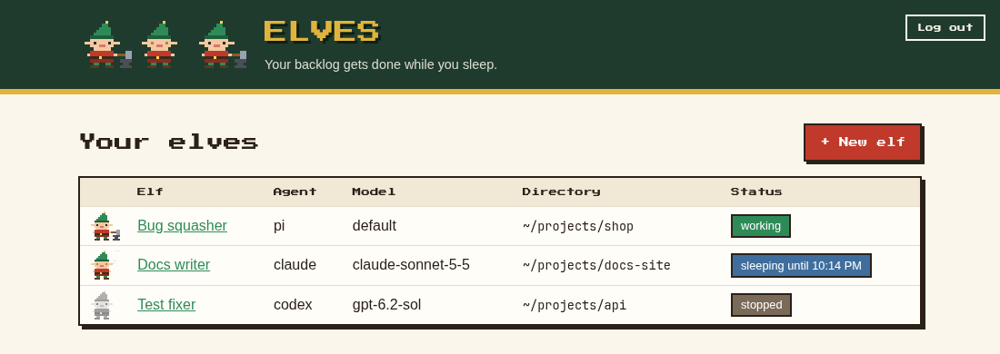

# Elves

**Your backlog gets done while you sleep.**

Elves runs coding agents in a loop. Each elf takes the next task from a backlog, does it, and
goes back for more. When the backlog is empty, it naps and checks again later.



## How an elf works

An elf is a loop around a coding agent: [pi](https://github.com/badlogic/pi-mono),
[Claude Code](https://docs.claude.com/en/docs/claude-code), [Codex](https://github.com/openai/codex)
or [opencode](https://opencode.ai).

```
forever:
  run the agent once, with the elf's prompt, in the elf's directory
  save the run (status, exit code, output)
  if the agent did a task:  run again straight away
  otherwise:                nap, then check again
```

Elves doesn't keep a backlog itself. The **prompt** tells the agent where the backlog lives and how
to pick the next item. That can be GitHub issues, a Notion board, a Markdown file, or anything else
the agent can reach. For example:

> Take the oldest open GitHub issue labeled `elves`, implement it, open a PR and comment on the issue.

To know when to nap, Elves adds one line to every prompt: if there is no task, the agent must end its
reply with `NO_TASK_AVAILABLE`.

## Features

- **Any of four agents**: pi, Claude Code, Codex or opencode, picked per elf.
- **Model dropdown** filled from each agent's own model list (`pi --list-models`, `opencode models`,
  `~/.codex/models_cache.json`; Claude has a fixed list).
- **Live output**: watch a running agent's tool calls and messages as they happen.
- **Run history**: every run is saved with its status, exit code and full output.
- **Max run time**: a run that takes too long is stopped, along with every command it started.
- **Stop or Force stop**: Stop lets the current run finish; Force stop ends it right away.
- **Login** with a username and password, safe to share over a tailnet.
- **Survives restarts**: elves that were working start again when the server comes back up.
- **Pixel-art elves** that hammer while working, snooze while napping, and go grey when stopped.

## Settings per elf

| Setting | Meaning |
|---|---|
| Name | Shown in the list |
| Agent | `pi`, `claude`, `codex` or `opencode` |
| Model | One of the agent's models, or "agent default" |
| Working directory | Where the agent runs. `~` works |
| Wait when there's nothing to do | Minutes to nap before checking again (default 30). Also used after a failed run |
| Max run time | Minutes one run may take before it's stopped and marked failed (default 60) |
| Prompt | Where the backlog is and how to pick the next item |

## Getting started

You need **Node 24 or newer**, plus at least one of the agents installed and logged in.

```sh
npm install
ELVES_USERNAME=me ELVES_PASSWORD='something long' npm start    # http://localhost:3000
```

Log in, click **+ New elf**, fill in the form, and press **Start**.

Environment variables:

| Variable  | Default      | Meaning |
|-----------|--------------|---------|
| `ELVES_USERNAME` | (required) | Username for the web interface |
| `ELVES_PASSWORD` | (required) | Password for the web interface |
| `HOST`    | `127.0.0.1`  | Address to listen on |
| `PORT`    | `3000`       | Web interface port |
| `DB_PATH` | `factory.db` | SQLite file with elves and runs |

The server won't start without a username and password. Restarting it logs you out.

After the first login, an elf pops up with a warning about what agents can do (see Safety below).
It keeps showing up until someone presses **I understand**.

### Reaching Elves from your tailnet

Keep Elves on localhost and let [Tailscale Serve](https://tailscale.com/kb/1312/serve) share it
with your tailnet over HTTPS:

```sh
tailscale serve --bg 3000      # https://<machine>.<tailnet>.ts.net
```

Or listen on the machine's tailnet address directly with `HOST=<tailscale-ip>` (plain HTTP, but
Tailscale encrypts the traffic between your devices).

## ⚠️ Safety

- **Agents run with full access and are never asked for permission.** Claude gets
  `--dangerously-skip-permissions` and Codex gets `--dangerously-bypass-approvals-and-sandbox`. pi
  and opencode allow everything by default. Nobody is around to approve anything, so an elf would
  get stuck otherwise. Only point elves at directories and backlogs you trust: whoever can write
  to the backlog can tell the agent what to do.
- **Anyone who can log in can make agents do anything.** Pick a strong password, and don't expose
  Elves to the open internet.
- **Other websites can't use your session.** The session cookie is signed and `SameSite=Lax`, so the
  browser leaves it off form posts from other sites, and requests that the browser marks as
  cross-site are refused. A random web page you visit can't create or start an elf.

## Good to know

- **Stopping an elf** lets its current run finish first; meanwhile it shows as "stopping" with a
  **Force stop** button that kills the agent right away (the run is marked `interrupted`).
  Stopping a napping elf takes effect at once.
- **Firing (deleting) an elf** is only possible once it's stopped.
- **The max run time** first asks the agent to stop; if it's still running 5 seconds later, it's killed.
- **A run that ends without a final message** counts as failed, so the elf naps instead of retrying
  in a tight loop.
- **Wait and max run time** go up to one week.
- **The elf page** shows the latest 50 runs, and warns when another elf works in the same folder.
- **Stopping the server** (Ctrl-C) also stops any agent that is still running. A run that gets cut
  off shows as `interrupted`.
- **Model lists** are read once at startup. Restart the server to pick up new models.

## Development

```sh
npm test           # unit tests
npm run coverage   # tests + coverage report in coverage/index.html
npm run typecheck
```

There's no build step: Node runs the TypeScript directly and uses its built-in `node:sqlite`.

| File | What it does |
|---|---|
| `src/server.ts` | Starts everything |
| `src/auth.ts` | Login, session cookie, cross-site check |
| `src/supervisor.ts` | The loop: run, record, nap |
| `src/agents.ts` | The command line for each agent |
| `src/runner.ts` | Runs an agent process, with the max run time and force stop |
| `src/parsers.ts` | Turns each agent's JSON output into a readable log |
| `src/live.ts` | Passes live output to whoever is watching |
| `src/models.ts` | Reads each agent's model list |
| `src/store.ts` | SQLite storage for elves, runs and settings |
| `src/app.ts` | The web routes |
| `src/form.ts` | The elf settings form and its validation |
| `src/layout.ts` | The page shell and CSS |
| `src/elves.ts` | The pixel-art elves |

In the code, an elf is called a *factory*.
